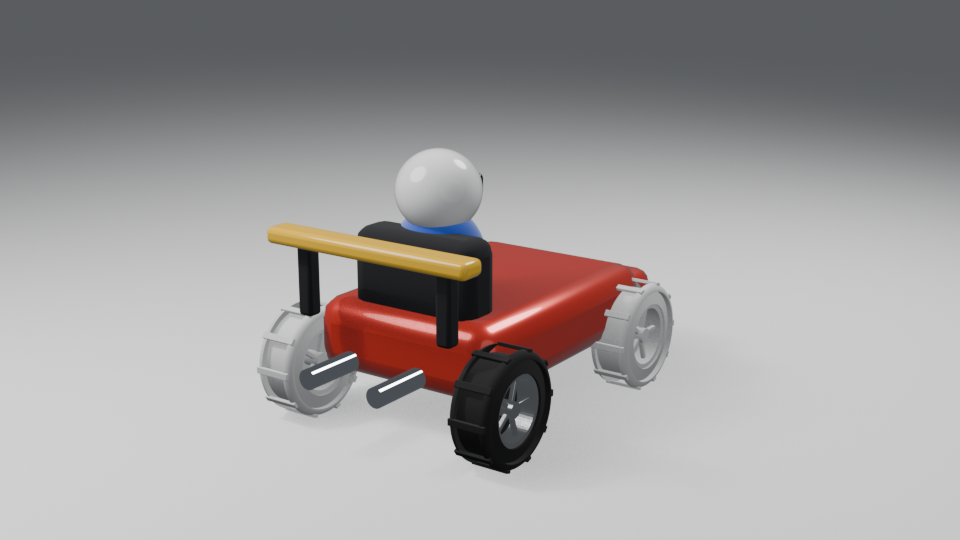
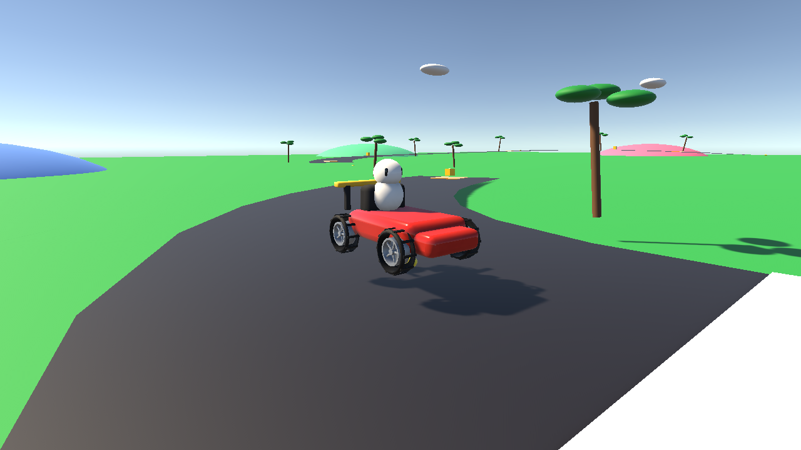
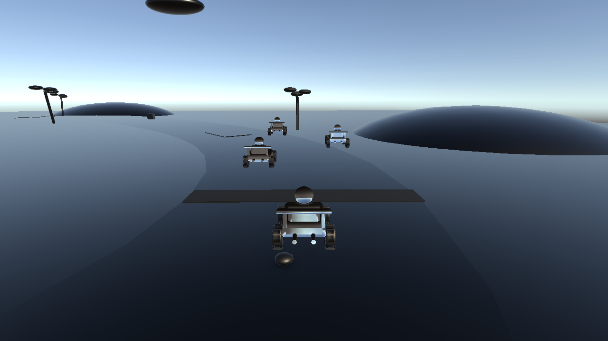
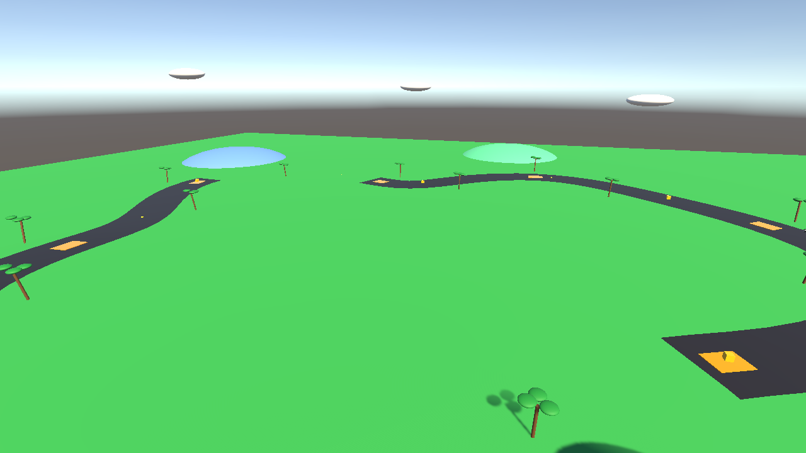
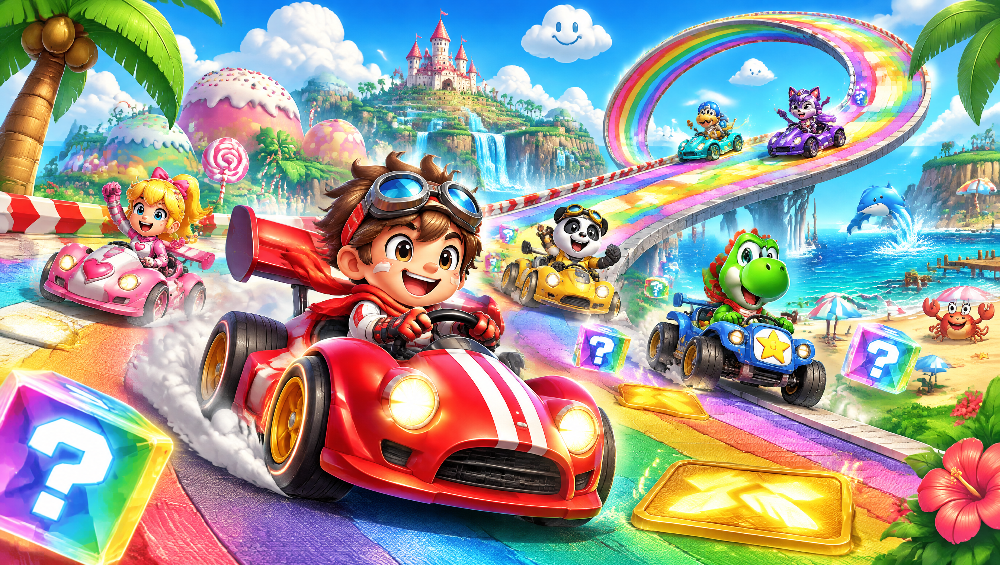

# Kartopia GP

An original, colorful arcade kart racer built with Unity 6 (URP), inspired by classic console kart racers. This is not affiliated with Nintendo or Sega and contains no Nintendo/Sega assets, names, tracks, or characters.

## Gameplay

- 3-lap closed-loop seaside circuit
- Player + 3 AI racers (RUBY, MINT, SUNNY)
- Drift charging and mini-turbo boost
- Golden item boxes that grant boost
- Orange boost pads
- Banana-peel slow hazards
- Live position, lap, timer, speed, and boost HUD
- Countdown and results screen
- Keyboard, arrows, and touch steering

## Art and tooling pipeline

- Kart model modeled in Blender and exported as GLB (`Assets/Models/kartopia_kart.glb`)
- Blender build script: `Tools/build_kart.py`
- Menu key art generated with Higgsfield (`Assets/Art/keyart.png`)
- Unity URP lighting, soft shadows, palms, candy hills, and clouds

## Screenshots

## Build

Open the project in Unity 6000.3.29f1, then run **Kartopia > Build Game + Android APK**.

Android package: `com.maximoseo.kartopia`
